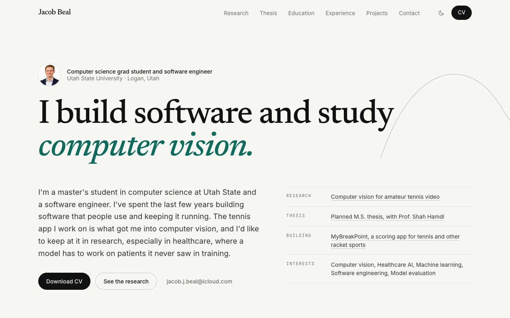
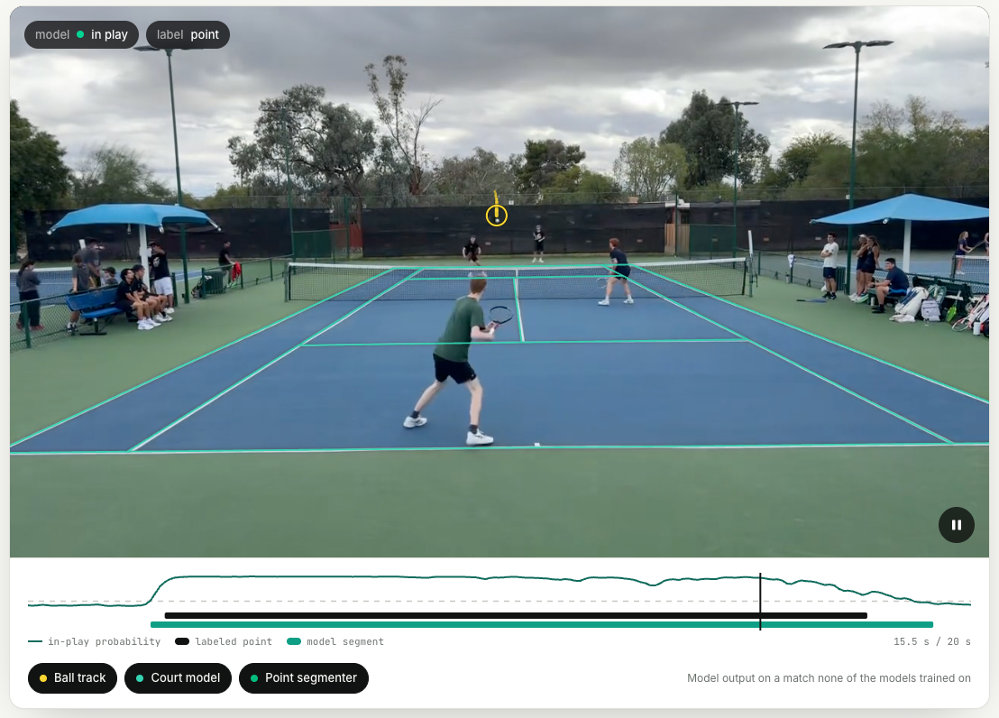

# jacobjbeal.com

My personal site. I'm a computer science grad student at Utah State University and a software engineer, and this is where my research, work and projects live.



The research section is about my work on computer vision for amateur tennis video. The demos on the page draw real model output from a match the models never trained on: the ball track, the court fit, and the in-play probability for every tenth of a second. You can turn layers off and scrub through the clip.



The models, the evaluation code and the technical report are in [mybreakpoint-vision-research](https://github.com/FroostySnoowman/mybreakpoint-vision-research).

## How it's put together

| Folder | What's in it |
| --- | --- |
| [`frontend/`](frontend) | The site: React 19, TypeScript, Vite, Tailwind 4 and Motion |
| [`backend/`](backend) | A small Hono API on Cloudflare Workers, with D1 for contact messages |

The Worker serves the built site as static assets and handles two routes:

- `POST /api/contact` saves a message to D1 and forwards it to Discord or email. It checks the origin, allows five messages an hour per visitor, and quietly drops anything that looks like a bot.
- `GET /api/ticketsx` returns live member counts for [TicketsX](https://ticketsx.xyz), cached at the edge for ten minutes.

## Running it locally

You need Node 22 or newer.

```bash
# API on :8787
cd backend
npm install
npm run d1:migrate:local
npm run dev

# site on :5173, proxies /api to the Worker
cd frontend
npm install
npm run dev
```

If port 8787 is taken, run the Worker with `npx wrangler dev --port 8799` and start the site with `API_ORIGIN=http://127.0.0.1:8799 npm run dev`.

## Deploying

The first time:

1. Create the database with `cd backend && npx wrangler d1 create jacobjbeal-db` and put the `database_id` it prints into `wrangler.toml`.
2. Apply the schema with `npm run d1:migrate:remote`.
3. Uncomment the `[[routes]]` blocks in `wrangler.toml` once the domain is on the Cloudflare account.
4. To get messages in Discord, add a webhook with `npx wrangler secret put DISCORD_WEBHOOK_URL`. For email, turn on Email Routing for the domain and uncomment `[[send_email]]` and `CONTACT_FROM`.

After that, `npm run deploy` from `backend/` builds the site and deploys it. Messages stay in D1 even if Discord or email fails:

```bash
npx wrangler d1 execute DB --remote --command "SELECT created_at, name, email, reason, body FROM messages ORDER BY id DESC LIMIT 20"
```

## Changing things

- Nearly all of the text is in [`frontend/src/content/profile.ts`](frontend/src/content/profile.ts).
- The CV is [`frontend/public/jacob-beal-cv.pdf`](frontend/public/jacob-beal-cv.pdf). Swap the file to update it.
- The demo clip and the model output it draws are in [`frontend/public/demo/`](frontend/public/demo).
- The demo components are in [`frontend/src/components/research/`](frontend/src/components/research). They only run while they're on screen, and they stay still for anyone who has reduced motion turned on.
